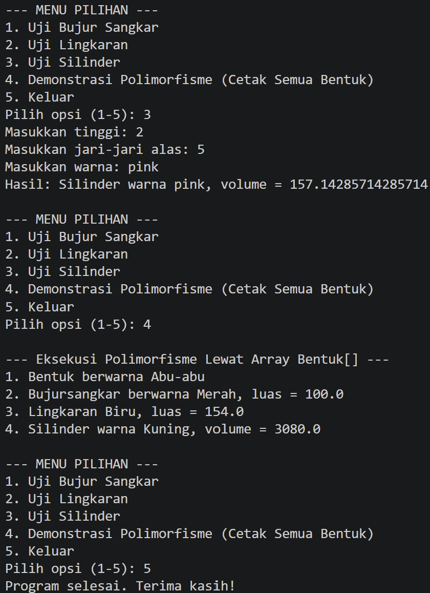

# Latihan PBO: Pewarisan dan Polimorfisme pada Hierarki Bentuk Geometri

Tugas mata kuliah Pemrograman Berorientasi Objek (PBO) yang memodelkan bentuk geometri dalam bahasa Java untuk memperlihatkan bagaimana empat pilar OOP, yaitu abstraksi, enkapsulasi, pewarisan, dan polimorfisme, bekerja dalam satu program yang utuh.

---

## Daftar Isi

1. [Identitas Mahasiswa](#identitas-mahasiswa)
2. [Deskripsi Program](#deskripsi-program)
3. [Struktur Direktori](#struktur-direktori)
4. [Hierarki Kelas](#hierarki-kelas)
5. [Rincian Setiap Kelas](#rincian-setiap-kelas)
6. [Penerapan Empat Pilar OOP](#penerapan-empat-pilar-oop)
7. [Letak Polimorfisme dalam Program](#letak-polimorfisme-dalam-program)
8. [Rumus Perhitungan](#rumus-perhitungan)
9. [Cara Menjalankan Program](#cara-menjalankan-program)
10. [Skenario Pengujian dan Hasil](#skenario-pengujian-dan-hasil)
11. [Bukti Tangkapan Layar](#bukti-tangkapan-layar)
12. [Catatan Perancangan](#catatan-perancangan)

---

## Identitas Mahasiswa

| Keterangan | Isi |
|---|---|
| Nama | Jauda Avaro Zufaru |
| NIM | F1D02410059 |
| Kelas | Pemrograman Berorientasi Objek C (PBO 5C) |
| Program Studi | Teknik Informatika, Fakultas Teknik, Universitas Mataram |

---

## Deskripsi Program

Program ini menyusun empat kelas yang saling berhubungan melalui pewarisan. Kelas `Bentuk` menjadi kelas induk yang hanya menyimpan warna. Dua kelas turunan langsung, `BujurSangkar` dan `Lingkaran`, menambahkan ukuran masing-masing beserta cara menghitung luasnya. Kelas `Silinder` diturunkan dari `Lingkaran` sehingga memakai kembali perhitungan luas lingkaran sebagai luas alas untuk menghitung volume.

Kelas `Main` menyediakan menu interaktif berbasis terminal. Pengguna dapat membuat objek dari setiap kelas dengan memasukkan ukuran dan warna, lalu melihat hasilnya. Satu menu khusus dipakai untuk memperlihatkan polimorfisme, yaitu ketika satu larik bertipe `Bentuk` diisi objek dari keempat kelas dan setiap objek mencetak informasinya dengan cara yang berbeda.

Program hanya memakai satu pustaka tambahan, yaitu `java.util.Scanner` untuk membaca masukan dari papan ketik.

---

## Struktur Direktori

```text
.
├── bin/
│   ├── Bentuk.class
│   ├── BujurSangkar.class
│   ├── Lingkaran.class
│   ├── Main.class
│   └── Silinder.class
├── screenshots/
│   ├── 01-uji-bangun-datar.png
│   └── 02-uji-bangun-ruang-dan-polimorfisme.png
├── src/
│   ├── Bentuk.java
│   ├── BujurSangkar.java
│   ├── Lingkaran.java
│   ├── Main.java
│   └── Silinder.java
└── README.md
```

Folder `src` berisi kode sumber, folder `bin` berisi hasil kompilasi, dan folder `screenshots` berisi bukti keluaran program yang ditampilkan pada bagian [Bukti Tangkapan Layar](#bukti-tangkapan-layar).

---

## Hierarki Kelas

```text
                 +------------------+
                 |      Bentuk      |   kelas induk (superclass)
                 |  - warna         |
                 +------------------+
                    /            \
     pewarisan     /              \     pewarisan
     tunggal      v                v     tunggal
   +----------------+        +----------------+
   |  BujurSangkar  |        |   Lingkaran    |
   |  - sisi        |        |  - radius      |
   +----------------+        +----------------+
                                     |
                                     |   pewarisan bertingkat
                                     v   (multilevel)
                             +----------------+
                             |    Silinder    |
                             |  - tinggi      |
                             +----------------+
```

Hubungan antarkelas dapat dibaca dengan pola "adalah sebuah" (*is-a*): bujur sangkar adalah sebuah bentuk, lingkaran adalah sebuah bentuk, dan silinder adalah sebuah lingkaran (sekaligus sebuah bentuk).

---

## Rincian Setiap Kelas

| Kelas | Induk | Atribut | Method utama | Keterangan |
|---|---|---|---|---|
| `Bentuk` | tidak ada | `warna` | `getWarna()`, `setWarna()`, `printInfo()` | Menyimpan sifat yang dimiliki semua bentuk. |
| `BujurSangkar` | `Bentuk` | `sisi` | `getSisi()`, `setSisi()`, `hitungLuas()`, `printInfo()` | Luas dihitung dari kuadrat sisi. |
| `Lingkaran` | `Bentuk` | `radius`, konstanta `PHI` | `getRadius()`, `setRadius()`, `hitungLuas()`, `printInfo()` | Luas dihitung dari `PHI` dan kuadrat radius. |
| `Silinder` | `Lingkaran` | `tinggi` | `getTinggi()`, `setTinggi()`, `hitungVolume()`, `printInfo()` | Volume memakai `hitungLuas()` warisan sebagai luas alas. |
| `Main` | tidak ada | tidak ada | `main()` | Menu interaktif dan demonstrasi polimorfisme. |

---

## Penerapan Empat Pilar OOP

### 1. Abstraksi

Abstraksi berarti hanya memodelkan hal yang dibutuhkan oleh masalah dan mengabaikan sisanya. Bentuk di dunia nyata memiliki banyak sifat, seperti bahan, berat, dan tekstur. Program ini hanya membutuhkan warna serta ukuran yang cukup untuk menghitung luas dan volume, sehingga hanya itulah yang dimasukkan ke dalam kelas.

Tiga keputusan abstraksi yang diambil dalam program:

- `warna` diletakkan pada `Bentuk` karena semua bentuk memilikinya, sehingga tidak perlu ditulis ulang di setiap kelas turunan.
- Ukuran ditaruh pada kelas yang memerlukannya saja, yaitu `sisi` pada `BujurSangkar`, `radius` pada `Lingkaran`, dan `tinggi` pada `Silinder`.
- Luas dan volume dihitung melalui method, bukan disimpan sebagai atribut. Nilai yang dapat diturunkan dari data lain lebih aman dihitung setiap kali dibutuhkan agar tidak menjadi usang ketika ukuran diubah melalui setter.

### 2. Enkapsulasi

Enkapsulasi melindungi data objek dari akses langsung di luar kelasnya. Semua atribut dideklarasikan `private`, dan kelas lain hanya dapat membaca atau mengubahnya melalui method `public`.

| Kelas | Atribut | Modifier | Getter | Setter |
|---|---|---|---|---|
| `Bentuk` | `warna` | `private` | `getWarna()` | `setWarna(String)` |
| `BujurSangkar` | `sisi` | `private` | `getSisi()` | `setSisi(double)` |
| `Lingkaran` | `radius` | `private` | `getRadius()` | `setRadius(double)` |
| `Silinder` | `tinggi` | `private` | `getTinggi()` | `setTinggi(double)` |

Akibat yang paling terlihat ada pada kelas turunan. Karena `warna` bersifat `private` di `Bentuk`, kelas `BujurSangkar`, `Lingkaran`, dan `Silinder` tidak dapat menulis `this.warna`. Ketiganya harus memanggil `getWarna()`, seperti pada baris berikut di `BujurSangkar.printInfo()`:

```java
System.out.println("Bujursangkar berwarna " + getWarna() + ", luas = " + hitungLuas());
```

### 3. Pewarisan

Pewarisan memungkinkan kelas turunan memakai atribut dan method kelas induk tanpa menuliskannya kembali. Kata kunci yang dipakai adalah `extends`.

| Kelas turunan | Kelas induk | Jenis | Yang diwarisi |
|---|---|---|---|
| `BujurSangkar` | `Bentuk` | Tunggal | `getWarna()`, `setWarna()`, dan `printInfo()` |
| `Lingkaran` | `Bentuk` | Tunggal | `getWarna()`, `setWarna()`, dan `printInfo()` |
| `Silinder` | `Lingkaran` | Bertingkat | `getRadius()`, `setRadius()`, `hitungLuas()`, konstanta `PHI`, serta seluruh method `Bentuk` |

Konstruktor kelas induk tidak diwariskan, tetapi harus dipanggil. Setiap konstruktor kelas turunan memanggil `super(...)` pada baris pertamanya sehingga data diteruskan naik melalui rantai pewarisan:

```java
// BujurSangkar dan Lingkaran
super(warna);

// Silinder meneruskan radius dan warna ke Lingkaran,
// lalu Lingkaran meneruskan warna ke Bentuk
super(radius, warna);
```

Saat `new Silinder(15, 7, "Toska")` dijalankan, urutan konstruktor yang bekerja adalah `Silinder`, memanggil `Lingkaran`, memanggil `Bentuk`. Eksekusi kemudian berjalan kembali dari `Bentuk` (mengisi `warna`), ke `Lingkaran` (mengisi `radius`), dan berakhir di `Silinder` (mengisi `tinggi`).

### 4. Polimorfisme

Polimorfisme berarti satu pemanggilan method dapat menghasilkan perilaku berbeda bergantung pada objek yang sebenarnya. Uraian lengkapnya ada pada bagian berikut.

---

## Letak Polimorfisme dalam Program

Polimorfisme dalam program ini berbentuk penimpaan method (*method overriding*) yang diselesaikan saat program berjalan (*runtime polymorphism*). Polimorfisme muncul di tiga tempat.

### a. Penimpaan `printInfo()` pada setiap kelas

Method `printInfo()` pertama kali ditulis di `Bentuk`, lalu ditimpa oleh ketiga kelas turunan dengan anotasi `@Override`. Nama dan parameternya sama, hanya isinya yang berbeda.

| Kelas | Berkas | Keluaran `printInfo()` |
|---|---|---|
| `Bentuk` | `Bentuk.java` | `Bentuk berwarna <warna>` |
| `BujurSangkar` | `BujurSangkar.java` | `Bujursangkar berwarna <warna>, luas = <luas>` |
| `Lingkaran` | `Lingkaran.java` | `Lingkaran <warna>, luas = <luas>` |
| `Silinder` | `Silinder.java` | `Silinder warna <warna>, volume = <volume>` |

Anotasi `@Override` bermanfaat karena kompilator akan menolak kode jika nama method atau parameternya tidak benar-benar cocok dengan method induk.

### b. Silinder menimpa versi milik Lingkaran

Penimpaan juga terjadi pada dua tingkat sekaligus. `Silinder` menimpa `printInfo()` milik `Lingkaran`, padahal `Lingkaran` sendiri sudah menimpa `printInfo()` milik `Bentuk`. Karena itu, walaupun `Silinder` mewarisi `hitungLuas()` dari `Lingkaran`, keluaran silinder tetap menampilkan volume dan bukan luas alas.

### c. Larik bertipe induk pada menu 4

Bagian ini adalah pembuktian utama. Pada `Main.java`, satu larik bertipe `Bentuk` diisi empat objek dari kelas yang berbeda:

```java
Bentuk[] daftarBentuk = {
    new Bentuk("Abu-abu"),
    new BujurSangkar(10.0, "Merah"),
    new Lingkaran(7.0, "Biru"),
    new Silinder(20.0, 7.0, "Kuning")
};

for (Bentuk b : daftarBentuk) {
    b.printInfo();
}
```

Semua elemen dipegang oleh variabel bertipe `Bentuk` (proses ini disebut *upcasting*), tetapi Java Virtual Machine memeriksa jenis objek yang sebenarnya pada saat `printInfo()` dipanggil, lalu menjalankan versi method milik kelas objek tersebut (*dynamic method dispatch*). Perulangan hanya berisi satu baris pemanggilan, tanpa percabangan `if` atau `instanceof`.

| Indeks | Tipe variabel | Tipe objek sebenarnya | Method yang dijalankan | Keluaran |
|---|---|---|---|---|
| 0 | `Bentuk` | `Bentuk` | `Bentuk.printInfo()` | `Bentuk berwarna Abu-abu` |
| 1 | `Bentuk` | `BujurSangkar` | `BujurSangkar.printInfo()` | `Bujursangkar berwarna Merah, luas = 100.0` |
| 2 | `Bentuk` | `Lingkaran` | `Lingkaran.printInfo()` | `Lingkaran Biru, luas = 153.93804002589985` |
| 3 | `Bentuk` | `Silinder` | `Silinder.printInfo()` | `Silinder warna Kuning, volume = 3078.7608005179973` |

Catatan mengenai *overloading*: program ini tidak memakai *method overloading* karena setiap kelas hanya memiliki satu konstruktor dan tidak ada method bernama sama dengan parameter berbeda. Seluruh polimorfisme pada program ini bersumber dari penimpaan.

---

## Rumus Perhitungan

| Kelas | Besaran | Rumus | Implementasi |
|---|---|---|---|
| `BujurSangkar` | Luas | L = s x s | `sisi * sisi` |
| `Lingkaran` | Luas | L = pi x r x r | `PHI * radius * radius` |
| `Silinder` | Volume | V = luas alas x tinggi | `hitungLuas() * tinggi` |

Konstanta pi dideklarasikan pada `Lingkaran` sebagai berikut:

```java
public static final double PHI = 3.141592653589793;
```

Kata `static` membuat konstanta ini milik kelas dan bukan milik tiap objek, sedangkan `final` mencegah nilainya diubah. Nama `PHI` dipertahankan mengikuti petunjuk pada materi perkuliahan.

Contoh penelusuran perhitungan untuk `Silinder(15, 7, "Toska")`:

1. Luas alas: 3,141592653589793 x 7 x 7 = 153,93804002589985.
2. Volume: 153,93804002589985 x 15 = 2309,070600388498 (bilangan yang dicetak Java sebagai `2309.070600388498`).

---

## Cara Menjalankan Program

### Prasyarat

- Java Development Kit (JDK) versi 8 atau lebih baru.
- Terminal atau Command Prompt.

Pengecekan pemasangan JDK dapat dilakukan dengan perintah berikut, dan keduanya harus menampilkan nomor versi:

```bash
java -version
javac -version
```

### Langkah-langkah

1. Salin repositori ke komputer lokal, lalu masuk ke direktorinya.

   ```bash
   git clone https://github.com/jaudaavaro/<nama-repo>.git
   cd <nama-repo>
   ```

2. Buat folder `bin` apabila belum ada.

   ```bash
   mkdir bin
   ```

3. Kompilasi seluruh berkas sumber. Opsi `-d bin` menempatkan berkas `.class` ke folder `bin`.

   ```bash
   javac -d bin src/*.java
   ```

   Pada Command Prompt Windows, jika pola `src/*.java` tidak dikenali, gunakan `javac -d bin src\*.java`.

4. Jalankan program melalui kelas `Main`. Opsi `-cp bin` memberi tahu Java letak berkas `.class`.

   ```bash
   java -cp bin Main
   ```

5. Ikuti menu yang tampil di terminal. Masukkan angka 1 sampai 5, lalu isi data yang diminta. Pilih 5 untuk keluar.

### Menjalankan melalui Visual Studio Code

Buka folder proyek, pastikan ekstensi Extension Pack for Java sudah terpasang, lalu buka `Main.java` dan klik tombol Run di atas method `main`. Masukan diketik pada panel Terminal.

### Catatan penggunaan

- Menu hanya menerima bilangan bulat. Memasukkan huruf pada saat diminta angka akan menghentikan program dengan `InputMismatchException`.
- Bilangan desimal ditulis dengan tanda titik, misalnya `12.5`, bukan `12,5`, sesuai aturan penulisan bilangan pada Java.
- Warna diketik bebas, boleh lebih dari satu kata.

---

## Skenario Pengujian dan Hasil

Data uji berikut dipilih agar hasilnya mudah dicek secara manual sekaligus mencakup setiap kelas. Hasil di bawah ini diperoleh dengan menjalankan program menggunakan masukan yang sama.

### Skenario 1: Bangun datar (menu 1 dan menu 2)

| Menu | Masukan | Perhitungan manual | Keluaran program |
|---|---|---|---|
| 1 | sisi `12.5`, warna `Jingga` | 12,5 x 12,5 = 156,25 | `Bujursangkar berwarna Jingga, luas = 156.25` |
| 2 | radius `14`, warna `Ungu` | 3,14159 x 14 x 14 = sekitar 615,75 | `Lingkaran Ungu, luas = 615.7521601035994` |

### Skenario 2: Bangun ruang dan polimorfisme (menu 3, menu 4, dan menu 5)

| Menu | Masukan | Perhitungan manual | Keluaran program |
|---|---|---|---|
| 3 | tinggi `15`, radius `7`, warna `Toska` | 153,938 x 15 = sekitar 2309,07 | `Silinder warna Toska, volume = 2309.070600388498` |
| 4 | tidak ada masukan tambahan | lihat tabel pada bagian polimorfisme | empat baris keluaran, satu untuk setiap objek dalam larik |
| 5 | tidak ada | tidak ada | `Program selesai.` |

Contoh alur masukan yang dapat diketik berurutan pada terminal:

```text
1
12.5
Jingga
2
14
Ungu
3
15
7
Toska
4
5
```

Keluaran penting dari menu 4:

```text
Cetak Semua Objek via Array Bentuk:
Bentuk berwarna Abu-abu
Bujursangkar berwarna Merah, luas = 100.0
Lingkaran Biru, luas = 153.93804002589985
Silinder warna Kuning, volume = 3078.7608005179973
```

Angka desimal yang panjang muncul karena tipe `double` menyimpan bilangan dalam representasi biner dan Java mencetaknya tanpa pembulatan. Selisih tipis dari hitungan manual pada digit terakhir termasuk wajar.

---

## Bukti Tangkapan Layar

### 1. Pengujian bangun datar

Menampilkan menu 1 (bujur sangkar, sisi 12.5, warna Jingga) dan menu 2 (lingkaran, radius 14, warna Ungu).


### 2. Pengujian bangun ruang dan polimorfisme

Menampilkan menu 3 (silinder, tinggi 15, radius 7, warna Toska), menu 4 (larik `Bentuk[]`), dan menu 5 (keluar).



---

## Catatan Perancangan

Beberapa keputusan perancangan yang sengaja diambil dan alasannya:

1. Atribut `private` pada `Bentuk`, bukan `protected`. Pilihan ini memaksa kelas turunan memakai getter sehingga prinsip enkapsulasi tetap terjaga sampai ke tingkat pewarisan.
2. `hitungVolume()` memanggil `hitungLuas()` warisan, bukan menuliskan ulang rumus lingkaran. Dengan begitu, jika rumus luas lingkaran diperbaiki, volume silinder ikut benar tanpa perubahan tambahan.
3. Objek pada menu 1 sampai 3 dibuat di dalam `case` dan tidak disimpan. Menu tersebut dimaksudkan sebagai uji cepat setiap kelas, sedangkan menu 4 menjadi tempat pembuktian polimorfisme.
4. `scanner.nextLine()` dipanggil setelah `nextInt()` dan `nextDouble()` untuk membuang karakter baris baru yang tersisa. Tanpa langkah ini, pertanyaan warna akan terlewati karena `nextLine()` langsung membaca sisa baris sebelumnya.
5. Program tidak memvalidasi ukuran negatif atau nol. Batasan ini disadari dan dapat ditambahkan pada setter di pengembangan berikutnya.
