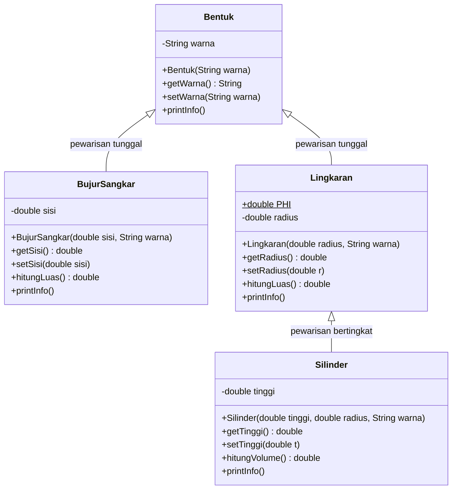
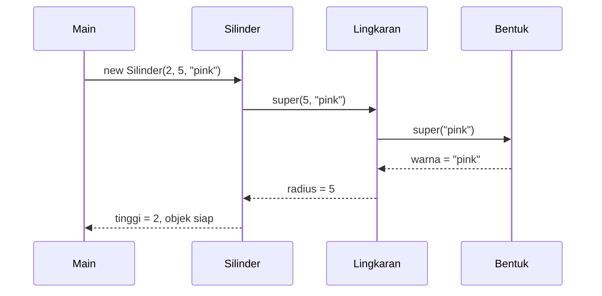
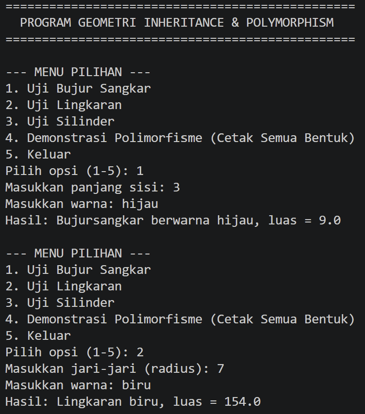

# LATIHAN PEMROGRAMAN BERORIENTASI OBJEK: ABSTRACTION, ENCAPSULATION, INHERITANCE, DAN POLYMORPHISM

### Hierarki Bentuk Geometri: Bentuk, Bujur Sangkar, Lingkaran, dan Silinder


-5382A1)


Program terminal yang memodelkan bentuk geometri dalam Java untuk memperlihatkan bagaimana empat pilar OOP, yaitu abstraksi, enkapsulasi, pewarisan, dan polimorfisme, bekerja bersama dalam satu program. Kelas `Bentuk` menjadi induk yang menyimpan warna, `BujurSangkar` dan `Lingkaran` menurunkannya dan menambahkan ukuran masing-masing, lalu `Silinder` diturunkan lagi dari `Lingkaran` agar dapat memakai ulang rumus luas lingkaran sebagai luas alas. Satu menu khusus memasukkan keempat jenis objek ke dalam satu larik bertipe `Bentuk`, dan setiap objek mencetak informasinya dengan cara yang berbeda.

---

## Daftar Isi

1. [Identitas](#1-identitas)
2. [Perintah Tugas dan Pemenuhannya](#2-perintah-tugas-dan-pemenuhannya)
3. [Deskripsi Program](#3-deskripsi-program)
4. [Struktur Proyek dan Rancangan Kelas](#4-struktur-proyek-dan-rancangan-kelas)
5. [Rincian Setiap Kelas](#5-rincian-setiap-kelas)
6. [Abstraksi](#6-abstraksi)
7. [Enkapsulasi](#7-enkapsulasi)
8. [Pewarisan](#8-pewarisan)
9. [Polimorfisme](#9-polimorfisme)
10. [Rumus Perhitungan](#10-rumus-perhitungan)
11. [Cara Menjalankan Program](#11-cara-menjalankan-program)
12. [Skenario Pengujian dan Screenshot](#12-skenario-pengujian-dan-screenshot)
13. [Catatan Perancangan dan Batasan](#13-catatan-perancangan-dan-batasan)

---

## 1. Identitas

| | |
|---|---|
| **Nama** | Jauda Avaro Zufaru |
| **NIM** | F1D02410059 |
| **Kelas** | 5C |
| **Mata kuliah** | Pemrograman Berorientasi Objek (MBS1302137) |
| **Dosen pengampu** | Royana Afwani, S.T., M.T. |
| **Program studi** | Teknik Informatika, Fakultas Teknik, Universitas Mataram |
| **Tugas** | 5C - Latihan/Eksplorasi Materi Inheritance dan Polymorphism |

---

## 2. Perintah Tugas dan Pemenuhannya

Penjelasan latihan terdapat pada halaman 63–66 materi *PBO 5 dan 6 - Abstraction, Encapsulation, Inheritance, Polymorphism*. Mahasiswa diminta mengeksplorasi pembuatan dan pemanggilan objek beserta method-methodnya di dalam method `main`, dan secara opsional membuat menu sederhana memakai `java.util.Scanner`. Repositori harus berisi kode dan README yang menjelaskan penggunaan encapsulation, inheritance, dan polymorphism pada kode, beserta screenshot.

| Ketentuan | Status | Uraian |
|---|---|---|
| Membuat dan memanggil objek beserta method-methodnya di `main` | Terpenuhi | Menu 1–4 membuat objek dari keempat kelas dan memanggil `printInfo()` |
| Menu sederhana dengan `Scanner` (opsional) | Terpenuhi | Lima menu interaktif di `Main` |
| Penjelasan encapsulation | Terpenuhi | [Bagian 7](#7-enkapsulasi) |
| Penjelasan inheritance | Terpenuhi | [Bagian 8](#8-pewarisan) |
| Penjelasan polymorphism | Terpenuhi | [Bagian 9](#9-polimorfisme) |
| Screenshot | Terpenuhi | [Bagian 12](#12-skenario-pengujian-dan-screenshot) |
| Penjelasan abstraction (tambahan) | Terpenuhi | [Bagian 6](#6-abstraksi) |

---

## 3. Deskripsi Program

`Main` menampilkan menu yang berulang sampai pengguna memilih keluar.

| Menu | Nama | Masukan | Yang dilakukan program |
|---|---|---|---|
| 1 | Uji Bujur Sangkar | sisi, warna | Membuat `BujurSangkar` lalu mencetak warna dan luasnya |
| 2 | Uji Lingkaran | radius, warna | Membuat `Lingkaran` lalu mencetak warna dan luasnya |
| 3 | Uji Silinder | tinggi, radius alas, warna | Membuat `Silinder` lalu mencetak warna dan volumenya |
| 4 | Demonstrasi Polimorfisme | – | Membuat larik `Bentuk[]` berisi empat objek berbeda lalu memanggil `printInfo()` pada setiap elemen |
| 5 | Keluar | – | Menghentikan perulangan dan menutup `Scanner` |

Program hanya memakai satu kelas dari pustaka standar, yaitu `java.util.Scanner`, untuk membaca masukan dari papan ketik.

---

## 4. Struktur Proyek dan Rancangan Kelas

### 4.1 Struktur Folder

```text
Latihan-Abstraction-Encapsulation-Inheritance-Polymorphism/
├── src/
│   ├── Bentuk.java         # kelas induk: warna
│   ├── BujurSangkar.java   # turunan Bentuk: sisi, luas
│   ├── Lingkaran.java      # turunan Bentuk: radius, PHI, luas
│   ├── Silinder.java       # turunan Lingkaran: tinggi, volume
│   └── Main.java           # menu interaktif dan demonstrasi polimorfisme
├── bin/                    # hasil kompilasi (.class)
├── screenshots/            # bukti keluaran program
└── README.md
```

### 4.2 Diagram Kelas



Hubungan antarkelas dibaca dengan pola "adalah sebuah" (*is-a*): bujur sangkar adalah sebuah bentuk, lingkaran adalah sebuah bentuk, dan silinder adalah sebuah lingkaran sekaligus sebuah bentuk.

---

## 5. Rincian Setiap Kelas

| Kelas | Induk | Atribut | Method | Keterangan |
|---|---|---|---|---|
| `Bentuk` | – | `warna` | `getWarna()`, `setWarna()`, `printInfo()` | Menyimpan sifat yang dimiliki semua bentuk |
| `BujurSangkar` | `Bentuk` | `sisi` | `getSisi()`, `setSisi()`, `hitungLuas()`, `printInfo()` | Luas = sisi × sisi |
| `Lingkaran` | `Bentuk` | `radius`, konstanta `PHI` | `getRadius()`, `setRadius()`, `hitungLuas()`, `printInfo()` | Luas = PHI × radius × radius |
| `Silinder` | `Lingkaran` | `tinggi` | `getTinggi()`, `setTinggi()`, `hitungVolume()`, `printInfo()` | Volume memakai `hitungLuas()` warisan sebagai luas alas |
| `Main` | – | – | `main()` | Menu interaktif dan demonstrasi polimorfisme |

---

## 6. Abstraksi

Abstraksi berarti hanya memodelkan hal yang dibutuhkan oleh masalah dan mengabaikan sisanya. Bentuk di dunia nyata memiliki banyak sifat, misalnya bahan, berat, dan tekstur, tetapi program ini hanya membutuhkan warna serta ukuran yang cukup untuk menghitung luas dan volume. Tiga keputusan abstraksi yang diambil:

- `warna` diletakkan pada `Bentuk` karena semua bentuk memilikinya, sehingga tidak perlu ditulis ulang di setiap kelas turunan.
- Ukuran ditaruh hanya pada kelas yang memerlukannya, yaitu `sisi` pada `BujurSangkar`, `radius` pada `Lingkaran`, dan `tinggi` pada `Silinder`.
- Luas dan volume dihitung melalui method, bukan disimpan sebagai atribut. Nilai yang dapat diturunkan dari data lain lebih aman dihitung setiap kali dibutuhkan agar tidak menjadi usang ketika ukuran diubah melalui setter.

Pada latihan ini `Bentuk` masih berupa kelas biasa (bukan `abstract class`), sehingga objek `new Bentuk("Abu-abu")` tetap dapat dibuat dan dipakai pada menu 4. Abstraksi di sini diterapkan sebagai cara memilih data dan perilaku yang dimodelkan, sedangkan kelas abstrak dan interface dibahas pada materi berikutnya.

---

## 7. Enkapsulasi

Enkapsulasi melindungi data objek dari akses langsung di luar kelasnya. Semua atribut dideklarasikan `private`, dan kelas lain hanya dapat membaca atau mengubahnya melalui method `public`.

| Kelas | Atribut | Modifier | Getter | Setter |
|---|---|---|---|---|
| `Bentuk` | `warna` | `private` | `getWarna()` | `setWarna(String)` |
| `BujurSangkar` | `sisi` | `private` | `getSisi()` | `setSisi(double)` |
| `Lingkaran` | `radius` | `private` | `getRadius()` | `setRadius(double)` |
| `Silinder` | `tinggi` | `private` | `getTinggi()` | `setTinggi(double)` |

Akibat yang paling terlihat ada pada kelas turunan. Karena `warna` bersifat `private` di `Bentuk`, kelas `BujurSangkar`, `Lingkaran`, dan `Silinder` tidak dapat menulis `this.warna`. Ketiganya harus memanggil `getWarna()`, seperti pada `BujurSangkar.printInfo()`:

```java
System.out.println("Bujursangkar berwarna " + getWarna() + ", luas = " + hitungLuas());
```

Satu-satunya anggota yang bersifat `public` dan bukan method adalah konstanta `PHI` di `Lingkaran`. Konstanta ini aman dibuka karena dideklarasikan `final`, sehingga nilainya tidak dapat diubah dari luar.

---

## 8. Pewarisan

Pewarisan memungkinkan kelas turunan memakai atribut dan method kelas induk tanpa menuliskannya kembali. Kata kunci yang dipakai adalah `extends`.

| Kelas turunan | Kelas induk | Jenis | Yang diwarisi |
|---|---|---|---|
| `BujurSangkar` | `Bentuk` | Tunggal | `getWarna()`, `setWarna()`, `printInfo()` |
| `Lingkaran` | `Bentuk` | Tunggal | `getWarna()`, `setWarna()`, `printInfo()` |
| `Silinder` | `Lingkaran` | Bertingkat (*multilevel*) | `getRadius()`, `setRadius()`, `hitungLuas()`, konstanta `PHI`, serta seluruh method `Bentuk` |

Konstruktor kelas induk tidak diwariskan, tetapi harus dipanggil. Setiap konstruktor kelas turunan memanggil `super(...)` pada baris pertamanya sehingga data diteruskan naik melalui rantai pewarisan:

```java
// BujurSangkar dan Lingkaran meneruskan warna ke Bentuk
super(warna);

// Silinder meneruskan radius dan warna ke Lingkaran,
// lalu Lingkaran meneruskan warna ke Bentuk
super(radius, warna);
```

Saat `new Silinder(2, 5, "pink")` dijalankan (tinggi 2, radius 5), urutan pemanggilan konstruktornya adalah `Silinder`, lalu `Lingkaran`, lalu `Bentuk`. Pengisian atribut kemudian berjalan dari atas ke bawah: `Bentuk` mengisi `warna`, `Lingkaran` mengisi `radius`, dan terakhir `Silinder` mengisi `tinggi`.



---

## 9. Polimorfisme

Polimorfisme berarti satu pemanggilan method dapat menghasilkan perilaku berbeda bergantung pada objek yang sebenarnya. Pada program ini polimorfisme berbentuk penimpaan method (*method overriding*) yang ditentukan saat program berjalan (*runtime polymorphism*), dan muncul di tiga tempat.

### 9.1 Penimpaan `printInfo()` pada Setiap Kelas

Method `printInfo()` pertama kali ditulis di `Bentuk`, lalu ditimpa oleh ketiga kelas turunan dengan anotasi `@Override`. Nama dan parameternya sama, hanya isinya yang berbeda.

| Kelas | Keluaran `printInfo()` |
|---|---|
| `Bentuk` | `Bentuk berwarna <warna>` |
| `BujurSangkar` | `Bujursangkar berwarna <warna>, luas = <luas>` |
| `Lingkaran` | `Lingkaran <warna>, luas = <luas>` |
| `Silinder` | `Silinder warna <warna>, volume = <volume>` |

Anotasi `@Override` membuat kompilator menolak kode jika nama atau parameter method tidak benar-benar cocok dengan method induk, sehingga salah ketik tidak diam-diam membuat method baru.

### 9.2 Silinder Menimpa Versi Milik Lingkaran

Penimpaan terjadi pada dua tingkat. `Silinder` menimpa `printInfo()` milik `Lingkaran`, padahal `Lingkaran` sendiri sudah menimpa `printInfo()` milik `Bentuk`. Karena itu, walaupun `Silinder` mewarisi `hitungLuas()` dari `Lingkaran`, keluaran silinder tetap menampilkan volume dan bukan luas alas.

### 9.3 Larik Bertipe Induk pada Menu 4

Bagian ini adalah pembuktian utama. Pada `Main.java`, satu larik bertipe `Bentuk` diisi empat objek dari kelas yang berbeda:

```java
Bentuk[] daftarBentuk = {
    new Bentuk("Abu-abu"),
    new BujurSangkar(10.0, "Merah"),
    new Lingkaran(7.0, "Biru"),
    new Silinder(20.0, 7.0, "Kuning")
};

for (int i = 0; i < daftarBentuk.length; i++) {
    System.out.print((i + 1) + ". ");
    daftarBentuk[i].printInfo();
}
```

Semua elemen dipegang oleh variabel bertipe `Bentuk` (*upcasting*), tetapi Java Virtual Machine memeriksa jenis objek yang sebenarnya saat `printInfo()` dipanggil, lalu menjalankan versi method milik kelas objek tersebut (*dynamic method dispatch*). Perulangan hanya berisi satu pemanggilan, tanpa percabangan `if` atau `instanceof`.

| Indeks | Tipe variabel | Tipe objek sebenarnya | Method yang dijalankan | Keluaran |
|---|---|---|---|---|
| 0 | `Bentuk` | `Bentuk` | `Bentuk.printInfo()` | `1. Bentuk berwarna Abu-abu` |
| 1 | `Bentuk` | `BujurSangkar` | `BujurSangkar.printInfo()` | `2. Bujursangkar berwarna Merah, luas = 100.0` |
| 2 | `Bentuk` | `Lingkaran` | `Lingkaran.printInfo()` | `3. Lingkaran Biru, luas = 154.0` |
| 3 | `Bentuk` | `Silinder` | `Silinder.printInfo()` | `4. Silinder warna Kuning, volume = 3080.0` |

Program ini tidak memakai *method overloading*, karena setiap kelas hanya memiliki satu konstruktor dan tidak ada method bernama sama dengan parameter berbeda. Seluruh polimorfisme pada program ini bersumber dari penimpaan.

---

## 10. Rumus Perhitungan

| Kelas | Besaran | Rumus | Implementasi |
|---|---|---|---|
| `BujurSangkar` | Luas | L = s × s | `sisi * sisi` |
| `Lingkaran` | Luas | L = π × r × r | `PHI * radius * radius` |
| `Silinder` | Volume | V = luas alas × t | `hitungLuas() * tinggi` |

Nilai π dideklarasikan pada `Lingkaran` sebagai pecahan 22/7:

```java
public static final double PHI = 22.0/7.0;
```

Kata `static` membuat konstanta ini milik kelas, bukan milik setiap objek, sedangkan `final` mencegah nilainya diubah. Penulisan `22.0/7.0` (bukan `22/7`) penting, karena pembagian dua bilangan bulat `22/7` di Java menghasilkan `3`, bukan 3,142857.

Contoh penelusuran untuk `Silinder(2, 5, "pink")`, sama dengan data pada screenshot kedua:

1. Luas alas: 22/7 × 5 × 5 = 550/7 ≈ 78,5714.
2. Volume: 550/7 × 2 = 1100/7 ≈ 157,142857, dicetak Java sebagai `157.14285714285714`.

Deret angka desimal yang panjang muncul karena 1100/7 adalah pecahan berulang dan tipe `double` dicetak tanpa pembulatan. Sebaliknya, jika radiusnya kelipatan 7, faktor 7 pada penyebut ikut habis sehingga hasilnya bilangan bulat, seperti lingkaran radius 7 pada menu 2 dan menu 4 yang luasnya tepat `154.0`.

Karena 22/7 (≈ 3,142857) sedikit lebih besar daripada π yang sebenarnya (≈ 3,141593), hasilnya sekitar 0,04% lebih besar dibanding perhitungan dengan `Math.PI`. Selisih ini wajar untuk latihan, dan keuntungannya hasil dengan radius kelipatan 7 menjadi bilangan bulat yang mudah diperiksa secara manual.

---

## 11. Cara Menjalankan Program

### 11.1 Kebutuhan

| Komponen | Keterangan |
|---|---|
| Bahasa | Java |
| Versi | JDK 8 atau lebih baru |
| Library | Tidak ada, hanya pustaka bawaan JDK (`java.util.Scanner`) |
| Sistem operasi | Windows, Linux, atau macOS |

Pastikan JDK sudah terpasang dengan perintah `java -version` dan `javac -version`.

### 11.2 Melalui Terminal

1. Clone repositori, lalu masuk ke foldernya.

   ```bash
   git clone https://github.com/avarozufaru/Latihan-Abstraction-Encapsulation-Inheritance-Polymorphism.git
   cd Latihan-Abstraction-Encapsulation-Inheritance-Polymorphism
   ```

2. Kompilasi semua berkas sumber ke folder `bin`.

   ```bash
   javac -d bin src/*.java
   ```

   Pada Command Prompt Windows, jika pola `src/*.java` tidak dikenali, gunakan `javac -d bin src\*.java`.

3. Jalankan kelas `Main`, lalu pilih menu dengan mengetik angka 1 sampai 5.

   ```bash
   java -cp bin Main
   ```

### 11.3 Melalui Visual Studio Code

Buka folder proyek, pastikan ekstensi **Extension Pack for Java** sudah terpasang, lalu buka `src/Main.java` dan klik **Run** di atas method `main`. Masukan diketik pada panel Terminal.

### 11.4 Catatan Penggunaan

- Menu hanya menerima bilangan bulat. Mengetik huruf saat diminta angka akan menghentikan program dengan `InputMismatchException`.
- Pemisah desimal yang diterima `Scanner` mengikuti pengaturan bahasa komputer. Pada komputer berbahasa Inggris ditulis dengan titik (`12.5`), sedangkan pada Windows berbahasa Indonesia harus ditulis dengan koma (`12,5`), karena di sana `12.5` dianggap tidak valid dan memicu `InputMismatchException`.
- Warna diketik bebas dan boleh lebih dari satu kata.

---

## 12. Skenario Pengujian dan Screenshot

### 12.1 Skenario Uji

Data uji berikut sama dengan data pada screenshot, dan mencakup setiap kelas. Semua masukan berupa bilangan bulat, sehingga skenario ini dapat diulang tanpa terpengaruh pengaturan pemisah desimal.

| Menu | Masukan | Perhitungan manual | Keluaran program |
|---|---|---|---|
| 1 | sisi `3`, warna `hijau` | 3 × 3 = 9 | `Hasil: Bujursangkar berwarna hijau, luas = 9.0` |
| 2 | radius `7`, warna `biru` | 22/7 × 7 × 7 = 154 | `Hasil: Lingkaran biru, luas = 154.0` |
| 3 | tinggi `2`, radius `5`, warna `pink` | 550/7 × 2 = 1100/7 ≈ 157,14 | `Hasil: Silinder warna pink, volume = 157.14285714285714` |
| 4 | – | lihat tabel pada [Bagian 9.3](#93-larik-bertipe-induk-pada-menu-4) | empat baris keluaran, satu untuk setiap objek |
| 5 | – | – | `Program selesai. Terima kasih!` |

Urutan masukan yang dapat diketik berurutan di terminal:

```text
1
3
hijau
2
7
biru
3
2
5
pink
4
5
```

Keluaran menu 4:

```text
--- Eksekusi Polimorfisme Lewat Array Bentuk[] ---
1. Bentuk berwarna Abu-abu
2. Bujursangkar berwarna Merah, luas = 100.0
3. Lingkaran Biru, luas = 154.0
4. Silinder warna Kuning, volume = 3080.0
```

### 12.2 Screenshot

#### 1. Pengujian Bangun Datar

Menu 1 (bujur sangkar, sisi 3, warna hijau, luas 9.0) dan menu 2 (lingkaran, radius 7, warna biru, luas 154.0).



#### 2. Pengujian Bangun Ruang dan Polimorfisme

Menu 3 (silinder, tinggi 2, radius 5, warna pink, volume 157.14285714285714), menu 4 (keempat objek dalam larik `Bentuk[]` mencetak informasinya masing-masing), dan menu 5 (keluar).


---

## 13. Catatan Perancangan dan Batasan

### 13.1 Keputusan Perancangan

1. **Atribut `private` pada `Bentuk`, bukan `protected`.** Pilihan ini memaksa kelas turunan memakai getter, sehingga enkapsulasi tetap terjaga sampai ke tingkat pewarisan.
2. **`hitungVolume()` memanggil `hitungLuas()` warisan.** Rumus luas lingkaran tidak ditulis ulang, sehingga jika rumus itu diperbaiki, volume silinder ikut benar tanpa perubahan tambahan.
3. **Objek pada menu 1–3 dibuat di dalam `case` dan tidak disimpan.** Menu tersebut dimaksudkan sebagai uji cepat setiap kelas, sedangkan menu 4 menjadi tempat pembuktian polimorfisme.
4. **`scanner.nextLine()` dipanggil setelah `nextInt()` dan `nextDouble()`.** Langkah ini membuang karakter baris baru yang tersisa. Tanpa langkah ini, pertanyaan warna akan terlewati karena `nextLine()` langsung membaca sisa baris sebelumnya.

### 13.2 Batasan yang Disadari

1. Ukuran negatif atau nol tidak divalidasi. Pemeriksaan ini dapat ditambahkan pada konstruktor dan setter.
2. Masukan selain angka pada pilihan menu atau ukuran akan menghentikan program dengan `InputMismatchException`.
3. Nilai π memakai pendekatan 22/7, sehingga hasilnya sedikit berbeda dari perhitungan dengan `Math.PI`.
